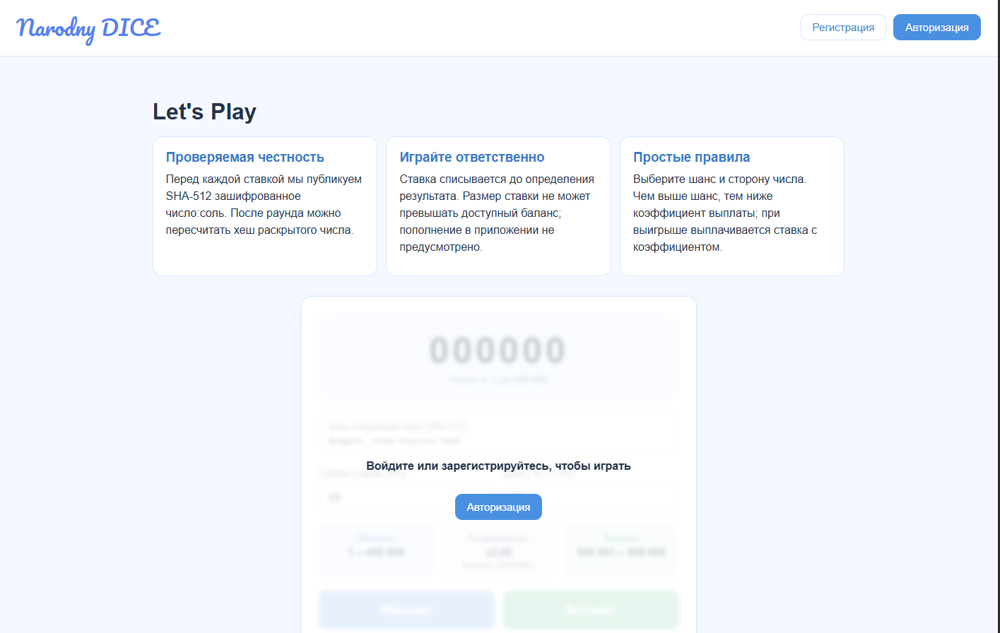
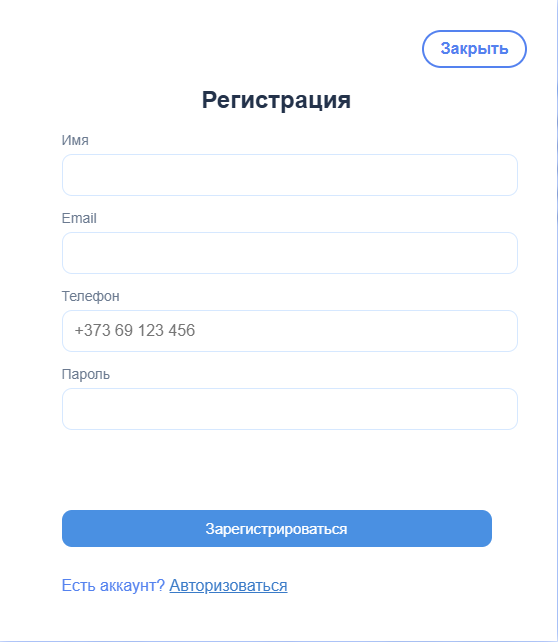
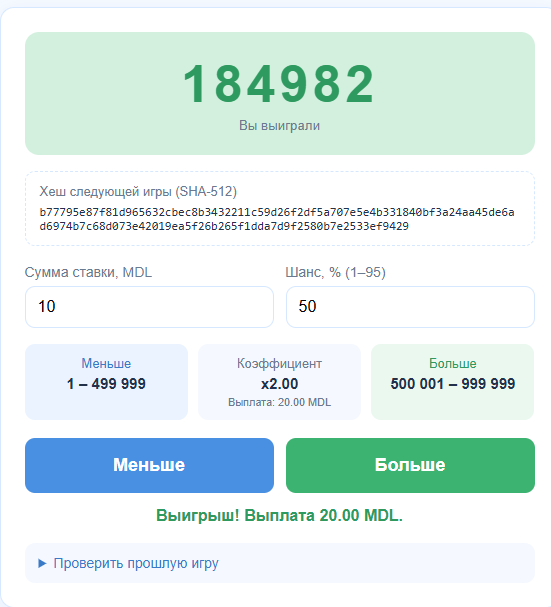
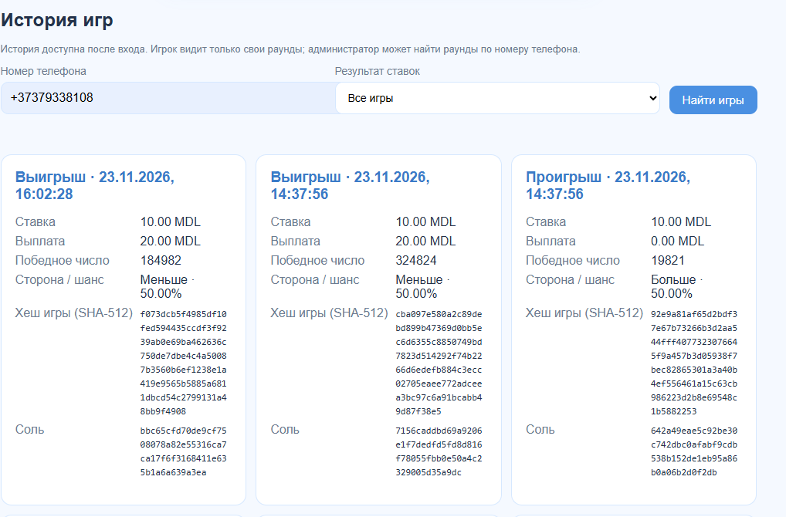
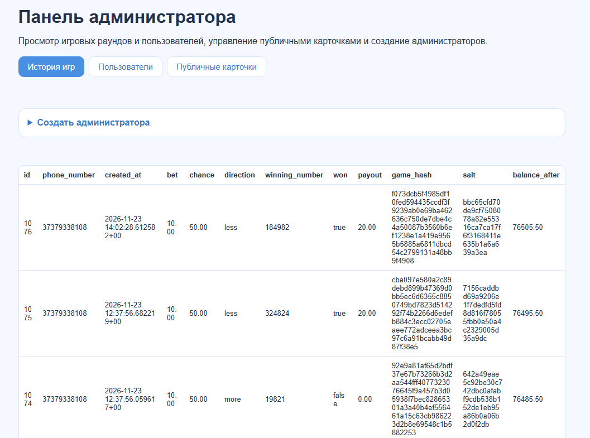

# Отчёт по индивидуальной работе

## Narodny DICE — веб-приложение с регистрацией, игрой и административной панелью

## Содержание

- [Описание лабораторной работы](#описание-лабораторной-работы)
- [Инструкции по запуску](#инструкции-по-запуску)
- [Функциональные возможности](#функциональные-возможности)
- [Сценарии взаимодействия](#сценарии-взаимодействия)
- [Архитектура и структура проекта](#архитектура-и-структура-проекта)
- [Структура базы данных](#структура-базы-данных)
- [Примеры использования](#примеры-использования)
- [Безопасность](#безопасность)
- [Ответы на контрольные вопросы](#ответы-на-контрольные-вопросы)
- [Ограничения и дальнейшее развитие](#ограничения-и-дальнейшее-развитие)
- [Источники](#источники)

## Описание лабораторной работы

**Цель работы** — разработать веб-приложение средней сложности с серверной обработкой запросов, хранением данных в реляционной базе данных, аутентификацией пользователей и защищёнными функциями для администратора.

**Задачи:** спроектировать таблицы PostgreSQL; реализовать регистрацию, вход и сессии; создать публичный динамический раздел; реализовать игру с сохранением результатов; добавить просмотр и фильтрацию истории; предоставить администратору инструменты управления данными; проверять ввод на клиенте и сервере.

**Narodny DICE** — традиционное клиент-серверное веб-приложение. Интерфейс реализован на HTML, CSS и JavaScript ES-модулях, серверная логика — на PHP, данные хранятся в PostgreSQL. PHP обращается к базе через PDO.

## Инструкции по запуску

### Требования

- PHP 8.1 или новее с расширениями `PDO`, `pdo_pgsql` и `openssl`.
- PostgreSQL 12 или новее.
- Современный браузер. Web Crypto API для проверки SHA-512 доступен на `localhost` и HTTPS.

### Настройка

1. Создайте базу данных PostgreSQL или выберите существующую.

2. Перед выполнением следующих команд задайте параметры подключения в PowerShell. Укажите пароль своей учётной записи PostgreSQL; не публикуйте его:

   ```powershell
   $env:DB_HOST = "localhost"
   $env:DB_PORT = "5432"
   $env:DB_NAME = "narodny_dice"
   $env:DB_USER = "postgres"
   $env:DB_PASS = "ваш-пароль"
   ```

   Если используется уже существующая база `postgres`, задайте `DB_NAME` равным `postgres`. Приложение читает эти переменные в `actions/config.php`.

3. Из корня проекта примените схему к выбранной базе:

   ```powershell
   psql -U $env:DB_USER -d $env:DB_NAME -f database\schema.sql
   ```

   Скрипт создаёт таблицы, индексы и три начальные публичные карточки. Учётная запись PostgreSQL должна иметь права на создание таблиц и индексов.

4. Убедитесь, что PHP загрузил драйвер PostgreSQL. В `php.ini`, используемом командой `php`, должны быть включены настройки:

   ```ini
   extension_dir="путь-к-папке-PHP\ext"
   extension=pdo_pgsql
   ```

   Путь `extension_dir` должен указывать на папку `ext` именно той установки PHP, которая запускает сервер. Проверьте конфигурацию:

   ```powershell
   php --ini
   php -m | Select-String 'PDO|pgsql'
   php -r "var_export(PDO::getAvailableDrivers());"
   ```

   В списке драйверов PDO должен присутствовать `pgsql`. Если `php --ini` сообщает, что конфигурационный файл не загружен, создайте `php.ini` рядом с используемым `php.exe` и откройте новое окно PowerShell.


5. Запустите встроенный PHP-сервер из корня проекта:

   ```powershell
   php -S localhost:8080
   ```

6. Откройте <http://localhost:8080/>. Переменные окружения должны быть заданы в том же окне PowerShell, из которого запускается PHP-сервер.

## Функциональные возможности

### Гость и публичная часть

- Главная страница показывает информационные карточки, загружаемые из таблицы `public_content` через `actions/public_content.php`.
- Гость может зарегистрироваться или открыть форму входа.
- Интерфейс игры доступен для просмотра, но игровые действия требуют авторизации.

### Пользователь

- Регистрация с именем, email, телефоном и паролем.
- Вход по email и паролю, выход с завершением сессии.
- Игра DICE: пользователь задаёт сумму ставки, шанс и направление («меньше» или «больше»).
- Просмотр собственной истории игр с фильтрами по номеру телефона и результату. Пользователь не может получить историю другого аккаунта.
- В раунде показываются число, соль и SHA-512-хеш, которые можно пересчитать в браузере.

### Администратор

Администратор имеет `access_level = 2`, обычный пользователь — `access_level = 1`. Панель `admin.php` предоставляет семь функций:

1. Просмотр истории игровых раундов.
2. Просмотр зарегистрированных пользователей.
3. Просмотр публичных карточек.
4. Добавление публичной карточки.
5. Редактирование публичной карточки.
6. Удаление публичной карточки.
7. Создание учётной записи администратора.

Панель и API проверяют роль на сервере; одной проверки интерфейса недостаточно для доступа к административным операциям.

### Соответствие требованиям о формах

В реализации есть формы регистрации и входа, игровая форма, форма поиска истории и административные формы карточек и создания администратора. Однако **форма создания ресурса и поиск ресурсов, указанные в задании, в текущей версии проекта не реализованы**. Поиск истории игр не является поиском ресурсов. В базе также нет таблицы каталога ресурсов. Это следует учитывать при оценке соответствия заданию.

Восстановление пароля по электронной почте также не реализовано.

## Сценарии взаимодействия

1. **Регистрация.** Гость открывает форму, указывает имя, email, телефон и пароль. Сервер проверяет данные, сохраняет хеш пароля, создаёт сессию и возвращает данные нового пользователя.
2. **Вход.** Пользователь отправляет email и пароль. Сервер получает хеш из базы, проверяет пароль, регенерирует идентификатор сессии и возвращает сведения об аккаунте.
3. **Игра.** Авторизованный пользователь выбирает ставку, вероятность и направление. Сервер заранее формирует секрет раунда и публикует его SHA-512-обязательство. После ставки сервер проверяет баланс, выполняет расчёт и сохраняет результат вместе с балансом в транзакции. Затем раскрываются число и соль предыдущего раунда.
4. **История.** Пользователь указывает собственный номер телефона и выбирает все, выигрышные или проигрышные раунды. Сервер проверяет принадлежность истории. Администратор может выполнять поиск по номеру другого пользователя.
5. **Проверка результата.** В интерфейсе можно повторно вычислить SHA-512 от строки `число:соль` и сравнить его с ранее опубликованным хешем.
6. **Администрирование.** Администратор переключается между списками пользователей, игр и публичных карточек; может добавлять, редактировать и удалять карточки, а также создавать администратора.

## Архитектура и структура проекта

Проект разделён на клиентскую часть, серверные обработчики и SQL-схему. Строгий MVC не используется; общие серверные функции собраны в утилитарном модуле.

| Путь | Назначение |
|---|---|
| `index.php` | Главная страница, публичные карточки, игра и форма истории |
| `admin.php` | Интерфейс панели администратора |
| `actions/config.php` | Параметры подключения к PostgreSQL |
| `actions/utility.php` | PDO, сессии, CSRF, проверка ролей, валидация и JSON-ответы |
| `actions/auth.php`, `actions/reg.php` | Вход и регистрация |
| `actions/session.php`, `actions/logout.php` | Данные сессии и выход |
| `actions/public_content.php` | Получение публичных карточек |
| `actions/game_state.php`, `actions/play.php` | Подготовка и проведение игрового раунда |
| `actions/game_history.php` | Защищённый поиск истории игр |
| `actions/admin_api.php` | Административные операции |
| `database/schema.sql` | Таблицы, ограничения, индексы и стартовые карточки |
| `js/` | Клиентские ES-модули, обработка форм и отрисовка |
| `css/style.css` | Стили приложения |
| `create_admin.php` | Создание первого администратора через CLI |

## Структура базы данных

| Таблица | Назначение и основные поля |
|---|---|
| `users` | Учётные записи и роли: `id`, `name`, `email`, `password_hash`, `balance`, `phone_number`, `access_level`, `reg_date` |
| `public_content` | Публичные карточки: `id`, `title`, `body`, `sort_order` |
| `game_rounds` | История и аудит игры: `user_id`, `bet`, `chance`, `direction`, `roll_value`, `won`, `payout`, `salt`, `commitment`, `balance_after`, `created_at` |

Связь `game_rounds.user_id` ссылается на `users.id`. Суммы хранятся в `NUMERIC(12,2)`. Ограничения базы запрещают отрицательный баланс, некорректную роль, направление игры вне разрешённого набора и значения игрового числа за установленным диапазоном. Уникальные индексы защищают email и игровое обязательство от дублирования.

## Примеры использования

**Главный экран неавторизованного пользователя**


**Регистрация**


**Окно игры**


**История игр**


**Админка**



**Хеширование пароля при регистрации** (`actions/reg.php`):

```php
$statement->execute([
    'name' => $name,
    'email' => $email,
    'password' => password_hash($password, PASSWORD_DEFAULT),
    'phone' => preg_replace('/\D+/', '', $phone),
]);
```

Пароль сохраняется с `password_hash()`, а при входе проверяется функцией `password_verify()`.

**Параметризованный поиск истории** (`actions/game_history.php`):

```php
$statement = $pdo->prepare(
    'SELECT gr.id, gr.created_at, gr.bet, gr.won, gr.commitment, gr.salt
     FROM game_rounds gr
     INNER JOIN users u ON u.id = gr.user_id
     WHERE regexp_replace(u.phone_number, \'[^0-9]\', \'\', \'g\') = :phone'
);
$statement->execute(['phone' => $phoneDigits]);
```


**Транзакция игрового раунда** (`actions/play.php`):

```php
$pdo->beginTransaction();
$userQuery = $pdo->prepare(
    'SELECT balance FROM users WHERE id = :id FOR UPDATE'
);
$userQuery->execute(['id' => $userId]);
// Проверка ставки, обновление баланса и добавление раунда.
$pdo->commit();
```

Блокировка строки пользователя и транзакция позволяют согласованно изменить баланс и записать результат раунда.

## Безопасность

- Пароли хранятся как хеши `PASSWORD_DEFAULT`, исходный пароль не сохраняется.
- Данные форм проверяются сервером; интерфейс также применяет HTML-ограничения и клиентские проверки.
- PDO использует подготовленные запросы для пользовательских значений.
- Сессии используют `HttpOnly`, `SameSite=Lax`; для HTTPS включается `Secure`. При входе и регистрации идентификатор сессии обновляется.
- Изменяющие запросы требуют CSRF-токен.
- Административные действия и история игр защищены серверной проверкой сессии и роли.
- Баланс и игровой результат изменяются внутри транзакции с блокировкой строки пользователя.
- SHA-512-обязательство даёт возможность проверить соответствие раскрытых числа и соли ранее показанному хешу.


## Ограничения и дальнейшее развитие

- При необходимости добавить восстановление пароля с одноразовыми токенами и проверенным почтовым сервисом.
- Для производственного применения игры использовать заранее фиксируемый и независимо проверяемый источник случайности.
- Добавить другие режимы игры
- Развивать возможности администраторов, добавить роль "суперадмина"
- Сделать имитацию пополнение баланса

## Источники

- PHP Manual: [PDO](https://www.php.net/manual/en/book.pdo.php), [Password Hashing](https://www.php.net/manual/en/overview.password.php), [Sessions](https://www.php.net/manual/en/book.session.php).
- PostgreSQL Documentation: [Transactions](https://www.postgresql.org/docs/current/tutorial-transactions.html), [Constraints](https://www.postgresql.org/docs/current/ddl-constraints.html).
- OWASP Cheat Sheet Series: [Authentication](https://cheatsheetseries.owasp.org/cheatsheets/Authentication_Cheat_Sheet.html), [CSRF Prevention](https://cheatsheetseries.owasp.org/cheatsheets/Cross-Site_Request_Forgery_Prevention_Cheat_Sheet.html), [SQL Injection Prevention](https://cheatsheetseries.owasp.org/cheatsheets/SQL_Injection_Prevention_Cheat_Sheet.html).
- MDN Web Docs: [Web Crypto API](https://developer.mozilla.org/en-US/docs/Web/API/Web_Crypto_API).
